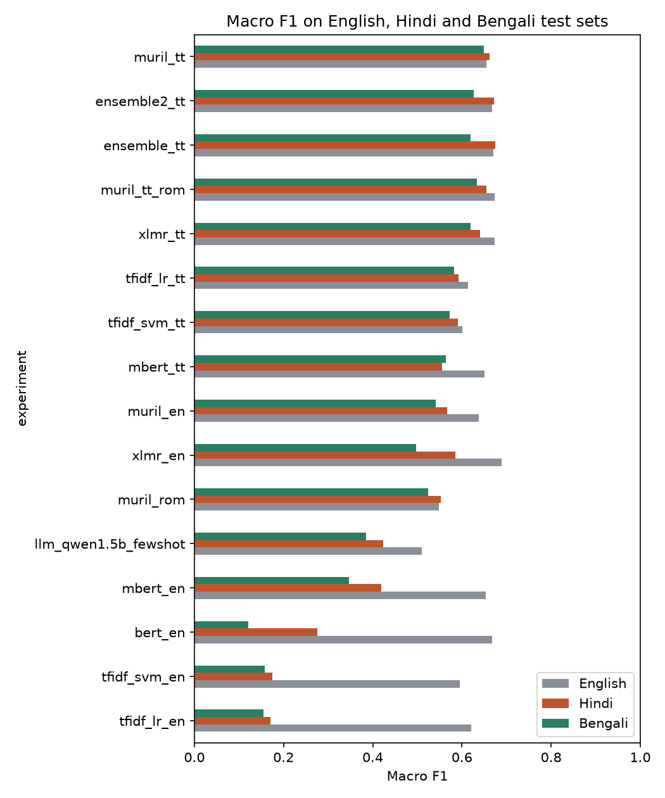

# Detecting Stance in Media on Global Warming for Indic Languages

Stance detection for **Hindi and Bengali** text towards the claim
**"Climate change and global warming is a serious concern."**
Each text is classified as **Favour**, **Against** or **None**. Main metric: **Macro F1**.

**Team:** Varun Sharma (S24CSEU0170), Yashika Garg (S24CSEU0235), Priyanshu Raj (S24CSEU1142), Advay Sinha (S24CSEU2059)
**Guide:** Dr. Supriya Chanda, SCSET, Bennett University
Individual responsibilities: [CONTRIBUTIONS.md](CONTRIBUTIONS.md)
**Full explanation of the project (for every team member):** [docs/PROJECT_GUIDE.md](docs/PROJECT_GUIDE.md)

> **Repository layout:** `src/` is the **Round 2 implementation** described in this README.
> The `stance/` package, `docs/01–06`, `reports/eda/` and `data/challenge/` come from our Milestone 1 exploration.
> That pipeline's own README is [docs/00_milestone1_pipeline.md](docs/00_milestone1_pipeline.md).

---

## 1. Base paper

> Yiwei Luo, Dallas Card, Dan Jurafsky. **"Detecting Stance in Media on Global Warming."** *Findings of EMNLP 2020*.
> Paper: https://aclanthology.org/2020.findings-emnlp.296 · arXiv: https://arxiv.org/abs/2010.15149 · DOI: [10.18653/v1/2020.findings-emnlp.296](https://doi.org/10.18653/v1/2020.findings-emnlp.296)
> Code and data: https://github.com/yiweiluo/GWStance

The authors built **GWSD**, a set of 2,050 English news sentences, each labelled by 8 annotators as agree / disagree / neutral towards *the same claim we use*. They fine-tuned **English BERT** and reported about 75% accuracy.

### What we improve over the base paper

| Base paper | Our project |
|---|---|
| English only | **Hindi and Bengali** (plus English) |
| Formal news sentences only | News + **social media** text (tweets), with a preprocessing step for noisy text (emojis, hashtags, mentions, URLs, repeated letters) |
| One model: English BERT | TF-IDF baselines, **multilingual transformers** (mBERT, XLM-R, MuRIL), an **LLM** (few-shot) and an **ensemble** |
| No handling of the rare "disagree" class | **Class-weighted loss**, Macro F1 as the main metric |
| No explanation of predictions | **LIME** explanations and error analysis |
| 2,050 training sentences | 5,630 English examples (GWSD + ClimateStance) **× 3 languages** via machine translation (translate-train augmentation) |

The key experiment: we train the **base paper's model** (English BERT on English data) and test it on Hindi and Bengali. Then we compare it with our multilingual, translate-train models on the same test sets (see Results).

---

## 2. Datasets (what to download)

You do **not** need to download anything by hand. `python src/download_data.py` downloads both files from their official links:

| Dataset | Official link | Content | Size used | Labels → ours |
|---|---|---|---|---|
| **GWSD** (base paper) | https://github.com/yiweiluo/GWStance (file `GWSD.tsv`) | English news sentences | 2,050 | agree → Favour, disagree → Against, neutral → None |
| **ClimateStance** (Vaid et al., ACL SRW 2022) | https://github.com/roopalv54/finegrained-climate-change-social-media · files: https://huggingface.co/datasets/eci-io/climate-evaluation (folder `ClimateStance`) | English tweets (COP25, Dec 2019) | 3,580 | favour (1) → Favour, against (2) → Against, ambiguous (0) → None |
| Hindi / Bengali versions | generated by `src/translate.py` | NLLB-200 machine translation of the two sets above | 5,630 each | same labels |
| Course dataset (when released) | from the instructor | Hindi/Bengali YouTube comments | – | Favour / Against / None |
| Our YouTube comments (in progress) | `src/collect_youtube.py` (YouTube Data API v3) | real Hindi/Bengali comments, labelled by the team | target 500 per language | Favour / Against / None |

**Splits** (identical for all three languages, so a sentence and its translations are always in the same split):

| Split | GWSD | ClimateStance | Total |
|---|---|---|---|
| train | 1,665 | 2,871 | 4,536 |
| val | 185 | 354 | 539 |
| test | 200 (authors' held-out set) | 355 (official) | 555 |

Statistics and plots: `results/dataset_stats.md`, `results/figures/class_distribution.png`.

> **Note on the test sets:** the Hindi and Bengali test sets are machine translations of the English test sets ("silver" data). They show how well models handle Hindi/Bengali text, but they are cleaner than real YouTube comments. Our own labelled YouTube comments and the course test set will be used for the final evaluation.

---

## 3. Method

```
English data (GWSD + ClimateStance)
        │  download_data.py   label mapping + splits
        ▼
Translate to Hindi & Bengali (NLLB-200)        translate.py
        ▼
Preprocessing                                  preprocess.py
  (HTML/Unicode normalise, URLs out, @user, hashtag split, emoji → words, repeated letters)
        ▼
Models
  ├─ TF-IDF (word + char n-grams) + LR / SVM   baselines.py
  ├─ English BERT  (base paper setting)        train_transformer.py --model bert
  ├─ mBERT / XLM-R / MuRIL                     train_transformer.py
  │     zero-shot (English only) vs translate-train (En + Hi + Bn)
  └─ Qwen2.5-1.5B-Instruct few-shot prompt     llm_fewshot.py
        ▼
Ensemble (average probabilities)               ensemble.py
        ▼
Evaluation: Macro F1, accuracy, precision, recall, confusion matrix
Explainability: LIME                           explain_lime.py
```

Training details: AdamW, lr 3e-5, batch 16, max length 128, 4 epochs with linear warm-up and decay, fp16, class-weighted cross-entropy. Best epoch is chosen by validation Macro F1. The word-embedding layer is frozen so that XLM-R and MuRIL fit in 4 GB of GPU memory.
MuRIL uses **mean pooling** over all tokens instead of the `[CLS]` token, and 6 epochs. Its `[CLS]` vector is nearly identical for every sentence (cosine similarity ≈ 1.0), and with the standard `[CLS]` head it only ever predicted the majority class (see Challenges).

---

## 4. Results

Macro F1 and accuracy on the test sets (555 examples per language). All numbers are produced by the scripts in this repo and stored in `results/metrics/*.json`; full table in [results/results_table.md](results/results_table.md).

| Model | Training data | F1 English | F1 Hindi | F1 Bengali | Acc Hindi | Acc Bengali |
|---|---|---|---|---|---|---|
| TF-IDF + LR | English only | 0.620 | 0.171 | 0.155 | 0.258 | 0.243 |
| **English BERT (base paper)** | English only | 0.667 | 0.275 | 0.120 | 0.501 | 0.218 |
| mBERT | English only (zero-shot) | 0.654 | 0.420 | 0.346 | 0.461 | 0.359 |
| XLM-R | English only (zero-shot) | 0.689 | 0.585 | 0.497 | 0.629 | 0.577 |
| MuRIL | English only (zero-shot) | 0.637 | 0.567 | 0.542 | 0.613 | 0.586 |
| Qwen2.5-1.5B LLM | Few-shot prompt | 0.510 | 0.424 | 0.384 | 0.539 | 0.533 |
| TF-IDF + LR | Translate-train | 0.614 | 0.592 | 0.583 | 0.692 | 0.694 |
| mBERT | Translate-train | 0.651 | 0.555 | 0.564 | 0.634 | 0.656 |
| XLM-R | Translate-train | 0.673 | 0.641 | 0.619 | 0.721 | 0.697 |
| **MuRIL (ours, best)** | Translate-train | 0.655 | **0.662** | **0.650** | 0.730 | 0.741 |
| Ensemble mBERT+XLM-R+MuRIL | Translate-train | 0.671 | 0.675 | 0.620 | 0.742 | 0.712 |
| Ensemble XLM-R+MuRIL | Translate-train | 0.667 | 0.672 | 0.626 | 0.746 | 0.717 |



**Key findings**
1. **Base paper reproduced:** English BERT trained on English reaches **75.0% accuracy** on English, the same as the ~75% reported by Luo et al. But on Hindi and Bengali it collapses to F1 **0.28 / 0.12**.
2. **Our best model (MuRIL, translate-train)** reaches F1 **0.662 (Hindi)** and **0.650 (Bengali)**, about **3.3× the base paper's approach** on Indic text, while keeping English performance (0.655).
3. **Translate-train beats zero-shot for every model**: +0.06 to +0.22 F1 on Hindi/Bengali. For TF-IDF it is the difference between useless (0.17) and usable (0.59).
4. **Indic-specific pre-training helps:** after translate-train, MuRIL > XLM-R > mBERT on both languages.
5. **Ensembles** help Hindi (best Hindi F1 0.675) but not Bengali, so MuRIL alone is our final model for now.
6. **A small LLM without training** (Qwen2.5-1.5B, few-shot) is much weaker (F1 0.42 / 0.38). Fine-tuning still matters.

**Romanised Hindi/Bengali** (the same test sets written in Latin letters, e.g. "global varmimg eka gambhir samasya hai"):

| Model | F1 Hi | F1 Bn | F1 Hi-romanised | F1 Bn-romanised |
|---|---|---|---|---|
| XLM-R translate-train | 0.641 | 0.619 | 0.236 | 0.143 |
| MuRIL translate-train | 0.662 | 0.650 | 0.521 | 0.487 |
| MuRIL trained from scratch with romanised copies (4 epochs) | 0.552 | 0.524 | 0.564 | 0.567 |
| **MuRIL translate-train + 2 more epochs with romanised copies** | 0.655 | 0.634 | **0.623** | **0.563** |

XLM-R almost fails on romanised text, while MuRIL (pre-trained with transliterated text) keeps working. Continued training with romanised copies adds **+0.10 / +0.08** F1 on romanised text for a small loss on native script. Training from scratch on all five versions underfitted in 4 epochs (loss still 1.02), so continuing from the trained model was the better choice. On the 64 hand-written comments the romanised model gets 10/15 romanised comments right (vs 9/15) but 2 fewer native-script ones, so **`muril_tt` stays our main model** and `muril_tt_rom` is the option for mostly-romanised input.

**Hand-written challenge set** (64 Hindi/Bengali comments in YouTube style, not translations): XLM-R macro F1 **0.68**, MuRIL **0.66**. Explicit statements are 100% correct; **sarcasm (38%)** and **romanized Hindi/Bengali (20%)** are the weak points ([results/challenge_set_results.md](results/challenge_set_results.md)).

**Error analysis** ([results/error_analysis_muril_tt.md](results/error_analysis_muril_tt.md)): 55% of errors are Favour ↔ None. ClimateStance's "ambiguous" class (which includes sarcastic tweets) maps poorly to our None (F1 < 0.15), while GWSD's neutral class reaches ~0.70–0.74.

**Explainability** ([results/lime/summary.md](results/lime/summary.md)): LIME shows sensible cues, e.g. ঝুঁকি / खतरा ("risk/danger") → Favour, না ("not") in "গ্লোবাল ওয়ার্মিং হচ্ছে না" → Against, प्रतिशत ("percent") in survey sentences → None.

### Challenges we hit (and fixes)
| Problem | Fix |
|---|---|
| MuRIL predicted only "Favour" (F1 0.26): its [CLS] vector is ~identical for every sentence | Mean pooling over all tokens (`src/models.py`) |
| ~0.4% of NLLB translations got stuck repeating a word ("ओह ओह ओह …") | Automatic detection + re-translation with repetition blocking (`translate.py --fix`) |
| XLM-R / MuRIL do not fit in a 4 GB GPU | Frozen word embeddings + fp16 |
| Only 13% "Against" | Class-weighted loss, Macro F1 model selection |
| LIME split Hindi/Bengali words into letters | Whitespace tokenisation for LIME |

### Next steps (before the final evaluation)
- Label real Hindi/Bengali YouTube comments (`src/collect_youtube.py`) and evaluate on the course test set when released.
- Transliterate romanized Hindi/Bengali to native script (IndicXlit); add sarcasm/romanized examples to training.
- LoRA fine-tuning of a multilingual LLM; weighted ensemble tuned on validation data.


---

## 5. How to run

```powershell
# 1. environment (Python 3.10–3.12)
py -3.12 -m venv .venv
.\.venv\Scripts\Activate.ps1
pip install torch --index-url https://download.pytorch.org/whl/cu126   # GPU; for CPU: pip install torch
pip install -r requirements.txt

# 2. full pipeline (about 1.5–2 hours on an RTX 2050 laptop GPU)
.\run_all.ps1

# or step by step
python src/download_data.py
python src/translate.py --langs hi bn
python src/data_stats.py
python src/baselines.py
python src/train_transformer.py --model muril --train_langs en hi bn --save
python src/ensemble.py --tags mbert_tt xlmr_tt muril_tt --name ensemble_tt
python src/llm_fewshot.py
python src/explain_lime.py --model_dir models/xlmr_tt
python src/summarize_results.py
```

**Demo / prediction:**
```powershell
python src/predict.py --model_dir models/muril_tt --text "ग्लोबल वार्मिंग एक गंभीर समस्या है"
python src/predict.py --model_dir models/muril_tt --input test.csv --id_col ID --text_col text --output submission.csv
```
The output file has the columns `ID, Predicted Label`, the format required for submission.

## 6. Repository structure

```
src/
  config.py              paths, labels, model names
  download_data.py       GWSD + ClimateStance → data/processed/english.csv
  translate.py           Hindi / Bengali translations (NLLB-200)
  preprocess.py          text cleaning
  romanize_data.py       romanised Hindi/Bengali copies (augmentation)
  evaluate_saved.py      score a saved model on any test set (e.g. romanised)
  eval_challenge.py      score models on the hand-written challenge set
  data_utils.py          loading data, metrics, confusion-matrix plots
  data_stats.py          dataset statistics and plots
  baselines.py           TF-IDF + LR / SVM
  train_transformer.py   BERT / mBERT / XLM-R / MuRIL fine-tuning
  llm_fewshot.py         Qwen2.5 few-shot LLM baseline
  ensemble.py            probability averaging
  explain_lime.py        LIME explanations
  predict.py             submission file / single-text demo
  collect_youtube.py     collect Hindi/Bengali YouTube comments for labelling
  summarize_results.py   results table and comparison chart
  models.py              [CLS] / mean-pooling classifiers (mean pooling used for MuRIL)
  error_analysis.py      errors by language, dataset and class
data/processed/          english.csv, hindi.csv, bengali.csv
data/challenge/          64 hand-written Hindi/Bengali comments (Milestone 1 challenge set)
results/                 metrics (JSON), predictions, figures, results_table.md, LIME output
docs/                    progress report generator, Milestone 1 documents
stance/, scripts/, reports/, runs/   Milestone 1 exploration pipeline
```

## 7. External resources used

Libraries: PyTorch, Hugging Face Transformers, scikit-learn, pandas, matplotlib, seaborn, emoji, LIME.
Pre-trained models: `bert-base-uncased`, `bert-base-multilingual-cased`, `xlm-roberta-base`, `google/muril-base-cased`, `facebook/nllb-200-distilled-600M` (translation), `Qwen/Qwen2.5-1.5B-Instruct` (LLM).
Datasets: GWSD (Luo et al., 2020), ClimateStance (Vaid et al., 2022).

## 8. References

1. Luo, Card, Jurafsky (2020). Detecting Stance in Media on Global Warming. Findings of EMNLP. https://doi.org/10.18653/v1/2020.findings-emnlp.296
2. Vaid, Pant, Shrivastava (2022). Towards Fine-grained Classification of Climate Change related Social Media Text. ACL SRW. https://doi.org/10.18653/v1/2022.acl-srw.35
3. Khanuja et al. (2021). MuRIL: Multilingual Representations for Indian Languages. https://arxiv.org/abs/2103.10730
4. Conneau et al. (2020). Unsupervised Cross-lingual Representation Learning at Scale (XLM-R). https://arxiv.org/abs/1911.02116
5. NLLB Team (2022). No Language Left Behind: Scaling Human-Centered Machine Translation. https://arxiv.org/abs/2207.04672
6. Ribeiro, Singh, Guestrin (2016). "Why Should I Trust You?" Explaining the Predictions of Any Classifier (LIME). https://arxiv.org/abs/1602.04938
7. Thapa et al. (2024). Stance and Hate Event Detection in Tweets Related to Climate Activism – Shared Task at CASE 2024. https://aclanthology.org/2024.case-1.33
