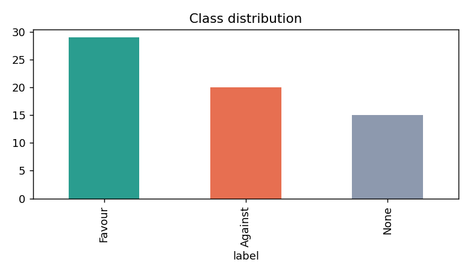
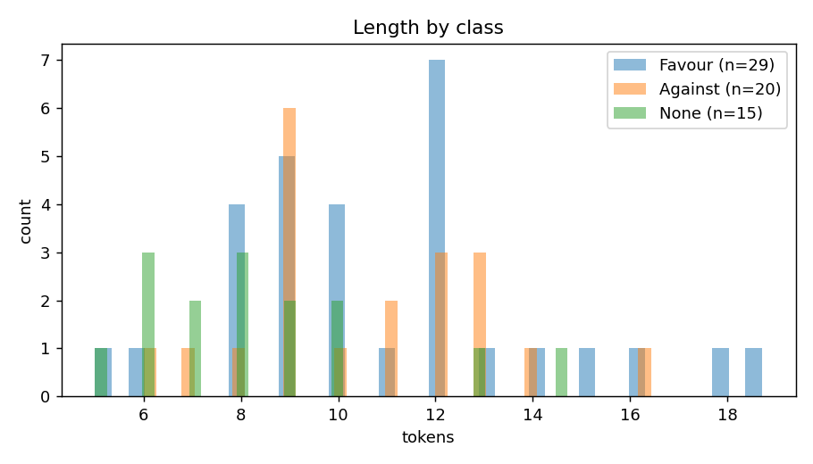
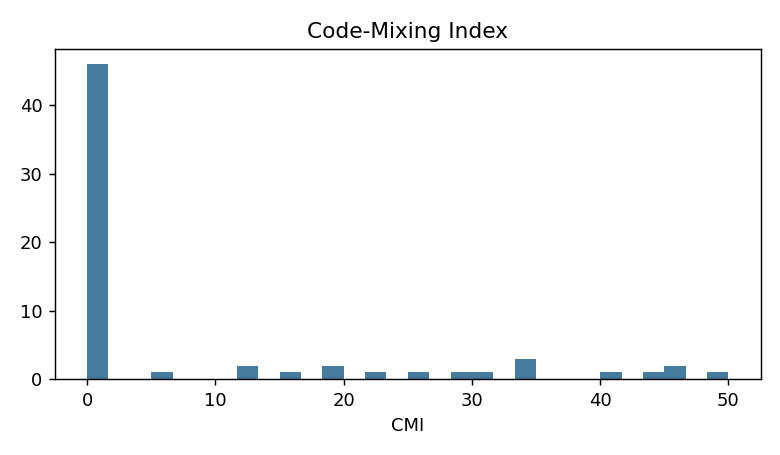

# EDA report: `challenge`

Files: data/challenge/challenge_hi_bn.csv

## 1. Size and quality

| metric | value |
|---|---|
| instances | 64 |
| empty texts | 0 |
| missing labels | 0 |
| exact duplicates | 0 |
| duplicates after normalisation | 0 |
| duplicate texts with CONFLICTING labels | 0 |

## 2. Class distribution

| label   |   count |   share |
|:--------|--------:|--------:|
| Favour  |      29 |   0.453 |
| Against |      20 |   0.312 |
| None    |      15 |   0.234 |

Imbalance ratio (max/min): 1.93

## 3. Language distribution

Given `lang` column vs script-based detection (`detected_lang`: hi, bn, en, hi-rom, bn-rom, mixed).

| lang   |   bn |   bn-rom |   en |   hi |   hi-rom |   All |
|:-------|-----:|---------:|-----:|-----:|---------:|------:|
| bn     |   22 |        0 |    0 |    0 |        0 |    22 |
| bn-rom |    0 |        6 |    0 |    0 |        0 |     6 |
| en     |    0 |        0 |    2 |    0 |        0 |     2 |
| hi     |    0 |        0 |    0 |   25 |        0 |    25 |
| hi-rom |    0 |        0 |    0 |    0 |        9 |     9 |
| All    |   22 |        6 |    2 |   25 |        9 |    64 |

### Label x language

| label   |   bn |   bn-rom |   en |   hi |   hi-rom |   All |
|:--------|-----:|---------:|-----:|-----:|---------:|------:|
| Against |    6 |        2 |    1 |    8 |        3 |    20 |
| Favour  |   11 |        2 |    1 |   11 |        4 |    29 |
| None    |    5 |        2 |    0 |    6 |        2 |    15 |
| All     |   22 |        6 |    2 |   25 |        9 |    64 |

## 4. Length statistics (by label)

| label   |   n |   chars_mean |   chars_median |   tokens_mean |   tokens_median |   tokens_p95 |   tokens_max |
|:--------|----:|-------------:|---------------:|--------------:|----------------:|-------------:|-------------:|
| Against |  20 |         57.4 |             59 |          10.6 |            10.5 |         14.2 |           17 |
| Favour  |  29 |         59.1 |             55 |          11   |            10   |         17.2 |           19 |
| None    |  15 |         44.7 |             42 |           8.5 |             8   |         13.6 |           15 |

### By language

| lang   |   n |   chars_mean |   chars_median |   tokens_mean |   tokens_median |   tokens_p95 |   tokens_max |
|:-------|----:|-------------:|---------------:|--------------:|----------------:|-------------:|-------------:|
| bn     |  22 |         52.4 |           50   |           8.5 |             8.5 |         12   |           13 |
| bn-rom |   6 |         46.8 |           47.5 |           8.7 |             8.5 |         10   |           10 |
| en     |   2 |         47.5 |           47.5 |           9   |             9   |          9   |            9 |
| hi     |  25 |         59.4 |           58   |          12.1 |            12   |         17.8 |           19 |
| hi-rom |   9 |         57.4 |           54   |          10.8 |            11   |         14.2 |           15 |

Share of texts > 128 tokens (whitespace): 0.000 -> informs `--max-len` for transformers.

## 5. Vocabulary

| metric | value |
|---|---|
| tokens | 658 |
| types | 453 |
| type/token ratio | 0.688 |
| hapax legomena | 361 (79.7% of types) |

Types per language: hi=185, hi-rom=72, bn=153, bn-rom=47, en=16

## 6. Social-media noise and code-mixing

| lang   |   n_emoji |   has_url |   has_mention |   has_hashtag |   has_elongation |   n_exclaim |   n_question |    cmi |
|:-------|----------:|----------:|--------------:|--------------:|-----------------:|------------:|-------------:|-------:|
| bn     |     0.318 |         0 |             0 |             0 |                0 |       0.182 |        0.227 |  0.758 |
| bn-rom |     0.333 |         0 |             0 |             0 |                0 |       0     |        0.167 | 22.817 |
| en     |     0     |         0 |             0 |             0 |                0 |       0     |        0     |  0     |
| hi     |     0.44  |         0 |             0 |             0 |                0 |       0.2   |        0.28  |  1.022 |
| hi-rom |     0.222 |         0 |             0 |             0 |                0 |       0     |        0.111 | 37.771 |

Texts with CMI > 0 (any mixing): 28.1%; CMI > 20: 18.8%

## 7. Linguistic cues per class

Rates of negation markers, explicit climate vocabulary, denial vocabulary (hoax/झूठ/মিথ্যা...), emoji, questions.

| label   |   has_negation |   has_climate_term |   has_denial_term |   n_emoji |   n_question |   n_exclaim |
|:--------|---------------:|-------------------:|------------------:|----------:|-------------:|------------:|
| Against |          0.1   |              0.85  |              0.35 |     0.4   |        0.15  |       0.05  |
| Favour  |          0.448 |              0.724 |              0    |     0.276 |        0.069 |       0.276 |
| None    |          0     |              0.333 |              0    |     0.4   |        0.6   |       0     |

Interpretation hints: if `None` has a low climate-term rate, relevance detection is easy; if `Against` has a high negation rate, the model may learn negation as a shortcut (check with the challenge set).

## 8. Frequent words (stopwords removed)

- **bn**: বিশ্ব (4), জলবায়ু (4), গ্লোবাল (4), উষ্ণায়ন (3), সমস্যা (3), করুন (3), ওয়ার্মিং (3), নয় (3), সত্যিই (2), গরম (2), এটা (2), আমাদের (2), যাচ্ছে (2), কী (2), কিছু (2), হবে। (2), তো (2), সবাই (2), হ্যাঁ (2), একটা (1), ভয়ঙ্কর (1), এখনই (1), ব্যবস্থা (1), নেওয়া (1), দরকার। (1)

- **bn-rom**: global (2), warming (2), serious (1), bepar (1), sobai (1), mile (1), kichu (1), korte (1), bhua (1), kotha (1), protibochor (1), pore (1), gaan (1), ta (1), chilo (1), video (1), te (1), climate (1), change (1), ekdom (1), real (1), keu (1), mazak (1), bhebo (1), eto (1)

- **en**: climate (1), change (1), biggest (1), threat (1), generation (1), global (1), warming (1), scam (1), tax (1)

- **hi**: ग्लोबल (8), वार्मिंग (7), है। (6), गर्मी (5), समस्या (3), जलवायु (3), हैं। (3), मौसम (3), सच (2), अभी (2), परिवर्तन (2), असर (2), पेड़ (2), कोई (2), असली (2), हमारे (2), इतनी (2), कौन (2), भाई (2), वीडियो (2), या (2), कल (2), करो (2), हाँ (2), ठंड (2)

- **hi-rom**: global (2), warming (2), climate (2), change (2), serious (1), problem (1), yaar (1), sabko (1), milke (1), chahiye (1), jhooth (1), har (1), saal (1), padti (1), ek (1), fake (1), agenda (1), western (1), countries (1), video (1), music (1), konsa (1), khatam (1), ped (1), kat (1)

## 9. Most class-distinctive words (log-odds, informative Dirichlet prior)

- **Favour**: सच (0.8), কিছু (0.8), अभी (0.8), real (0.8), रहो (0.8), আমাদের (0.8), যাচ্ছে (0.8), असर (0.8), সত্যিই (0.8), पेड़ (0.8), এটা (0.8), mazak (0.8), serious (0.8), climate (0.8), change (0.8)

- **Against**: গ্লোবাল (1.5), ওয়ার্মিং (1.3), इतनी (1.1), हाँ (1.1), হ্যাঁ (1.1), वार्मिंग (0.8), হয়ে (0.8), এত (0.8), नाटक (0.8), kotha (0.8), protibochor (0.8), कमाल (0.8), padti (0.8), দূর (0.8), फालतू (0.8)

- **None**: या (1.3), video (1.3), वीडियो (1.3), मौसम (0.9), चेंज (0.9), chilo (0.9), कहा (0.9), chala (0.9), cream (0.9), দপ্তর (0.9), शुरू (0.9), आएगा (0.9), क्लाइमेट (0.9), कब (0.9), बता (0.9)

## 10. Random examples per class

- [Favour] पेड़ लगाओ, पानी बचाओ, वरना आने वाली पीढ़ी हमें माफ़ नहीं करेगी 🙏

- [Favour] সরকার কিছু করবে না, আমাদেরই পরিবেশ বাঁচাতে হবে।

- [Favour] চমৎকার, পুকুর বুজিয়ে ফ্ল্যাট বানাও, তারপর গরমে কাঁদো 👏

- [Against] eto thanda porche ar era bolche global warming 🤣

- [Against] गर्मी तो हमेशा से पड़ती आई है, इसमें नया क्या है? फालतू का डर फैला रहे हैं।

- [Against] Global warming is a scam to tax us more.

- [None] आज मैच कौन जीतेगा? इंडिया या ऑस्ट्रेलिया?

- [None] bhai video ka music konsa hai?

- [None] দাদা ভিডিওটা দারুণ হয়েছে, পরের ভিডিও কবে আসবে?

## Figures

