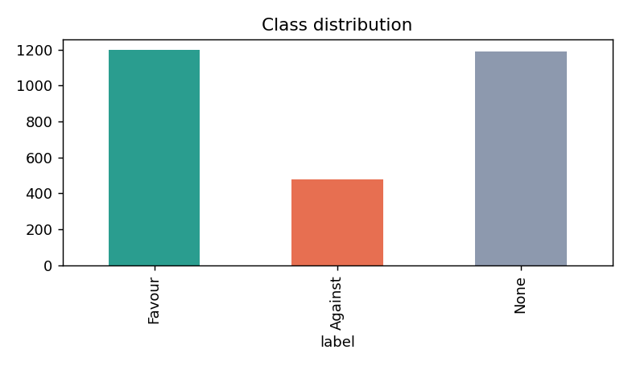
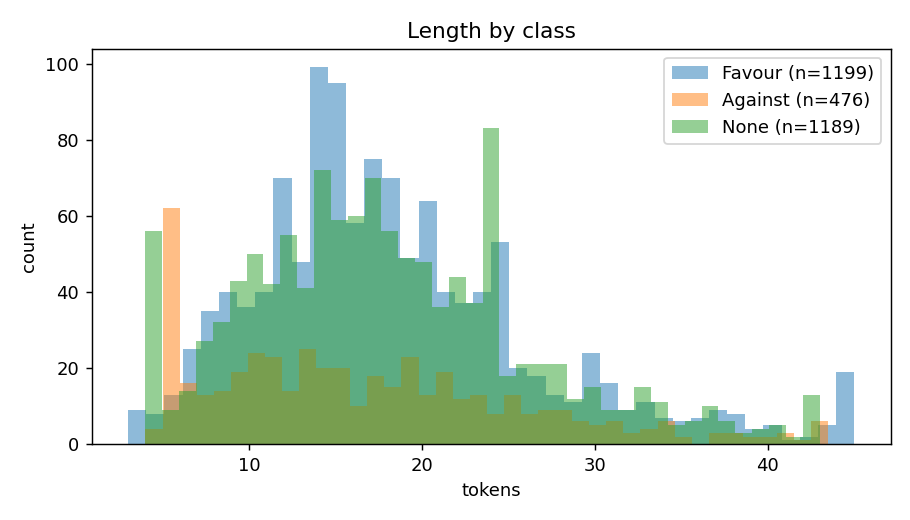
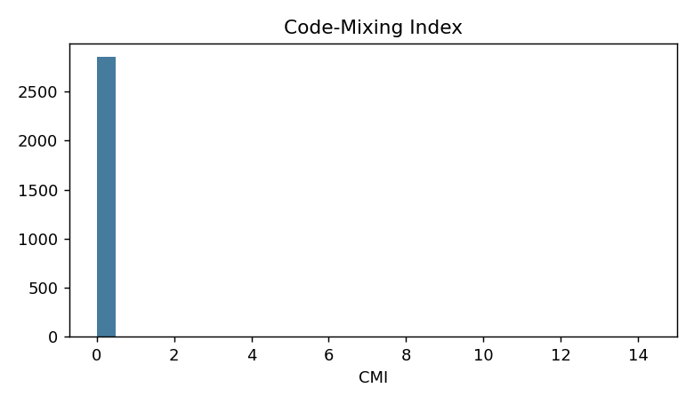

# EDA report: `external_en`

Files: data/external/processed\gwsd.csv, data/external/processed\semeval2016_climate.csv

## 1. Size and quality

| metric | value |
|---|---|
| instances | 2864 |
| empty texts | 0 |
| missing labels | 0 |
| exact duplicates | 254 |
| duplicates after normalisation | 254 |
| duplicate texts with CONFLICTING labels | 2 |

## 2. Class distribution

| label   |   count |   share |
|:--------|--------:|--------:|
| Favour  |    1199 |   0.419 |
| Against |     476 |   0.166 |
| None    |    1189 |   0.415 |

Imbalance ratio (max/min): 2.52

## 3. Language distribution

Given `lang` column vs script-based detection (`detected_lang`: hi, bn, en, hi-rom, bn-rom, mixed).

| lang   |   en |   All |
|:-------|-----:|------:|
| en     | 2864 |  2864 |
| All    | 2864 |  2864 |

### Label x language

| label   |   en |   All |
|:--------|-----:|------:|
| Against |  476 |   476 |
| Favour  | 1199 |  1199 |
| None    | 1189 |  1189 |
| All     | 2864 |  2864 |

## 4. Length statistics (by label)

| label   |    n |   chars_mean |   chars_median |   tokens_mean |   tokens_median |   tokens_p95 |   tokens_max |
|:--------|-----:|-------------:|---------------:|--------------:|----------------:|-------------:|-------------:|
| Against |  476 |         98.9 |           90.5 |          16.4 |              15 |         34   |           54 |
| Favour  | 1199 |        110.5 |          103   |          18.4 |              17 |         35.1 |           58 |
| None    | 1189 |        107.2 |          101   |          18   |              17 |         34   |           60 |

### By language

| lang   |    n |   chars_mean |   chars_median |   tokens_mean |   tokens_median |   tokens_p95 |   tokens_max |
|:-------|-----:|-------------:|---------------:|--------------:|----------------:|-------------:|-------------:|
| en     | 2864 |        107.2 |            101 |          17.9 |              17 |           34 |           60 |

Share of texts > 128 tokens (whitespace): 0.000 -> informs `--max-len` for transformers.

## 5. Vocabulary

| metric | value |
|---|---|
| tokens | 51350 |
| types | 6423 |
| type/token ratio | 0.125 |
| hapax legomena | 3455 (53.8% of types) |

Types per language: en=6423

**OOV vs comparison set** (data/challenge/challenge_hi_bn.csv): 99.5% of types, 79.4% of tokens are unseen -> lexical overlap is low; motivates subword / multilingual models.

## 6. Social-media noise and code-mixing

| lang   |   n_emoji |   has_url |   has_mention |   has_hashtag |   has_elongation |   n_exclaim |   n_question |   cmi |
|:-------|----------:|----------:|--------------:|--------------:|-----------------:|------------:|-------------:|------:|
| en     |         0 |         0 |          0.08 |          0.14 |            0.013 |       0.044 |        0.035 | 0.027 |

Texts with CMI > 0 (any mixing): 0.5%; CMI > 20: 0.0%

## 7. Linguistic cues per class

Rates of negation markers, explicit climate vocabulary, denial vocabulary (hoax/झूठ/মিথ্যা...), emoji, questions.

| label   |   has_negation |   has_climate_term |   has_denial_term |   n_emoji |   n_question |   n_exclaim |
|:--------|---------------:|-------------------:|------------------:|----------:|-------------:|------------:|
| Against |          0.216 |              0.878 |             0.153 |         0 |        0.011 |       0.019 |
| Favour  |          0.085 |              0.715 |             0.007 |         0 |        0.038 |       0.043 |
| None    |          0.103 |              0.549 |             0.01  |         0 |        0.04  |       0.055 |

Interpretation hints: if `None` has a low climate-term rate, relevance detection is easy; if `Against` has a high negation rate, the model may learn negation as a shortcut (check with the challenge set).

## 8. Frequent words (stopwords removed)

- **en**: global (973), warming (791), climate (752), change (446), carbon (384), user (355), sea (260), emissions (232), ice (194), over (190), fossil (177), years (169), rise (165), human (163), level (161), dioxide (142), levels (140), world (130), temperatures (120), increase (115), some (115), fuels (115), united (105), states (103), effects (97)

## 9. Most class-distinctive words (log-odds, informative Dirichlet prior)

- **Favour**: health (4.8), welfare (4.4), dangerous (4.4), happening (4.2), human (3.8), cfcc15 (2.9), tip (2.9), mission (2.8), change (2.8), next (2.7), level (2.7), extreme (2.6), threaten (2.6), climate (2.5), alarming (2.5)

- **Against**: hoax (6.7), warming (6.3), global (5.2), data (2.8), science (2.5), alarmists (2.5), man (2.5), evidence (2.4), scare (2.4), exaggerated (2.3), false (2.1), alarmist (2.1), chinese (2.1), natural (2.0), lose (1.9)

- **None**: cute (4.7), icebergs (4.7), counteracted (4.7), lingering (4.7), recession (4.6), business (4.4), some (4.4), growth (4.3), seen (4.3), several (4.2), carbon (4.2), united (4.1), states (4.0), past (3.7), increase (2.7)

## 10. Random examples per class

- [Favour] We need to “ do the math, ” which is to take the known fossil fuel reserves that oil and gas companies expect to tap and add that to the carbon already trapped in the atmosphere.

- [Favour] The hidden health and environmental costs of using fossil fuels are far greater than previously thought.

- [Favour] Damage to Great Barrier Reef From Global Warming Is Irreversible.

- [Against] Global warming doesn’t worry me — at least not in a gut-twisting, obsessive way.

- [Against] There is little evidence to support claims, such as those by Al Gore, that the sea would rise by 20 feet by the end of the century.

- [Against] Policies designed to curb global warming would hurt the economy.

- [None] Some icebergs are cute.

- [None] The fossil fuel industry may be emitting twice as much methane as previously thought.

- [None] A real investment in getting off the fossil fuel addiction is far more likely to produce long-term, high-paying jobs than building the Keystone XL pipeline.

## Figures

